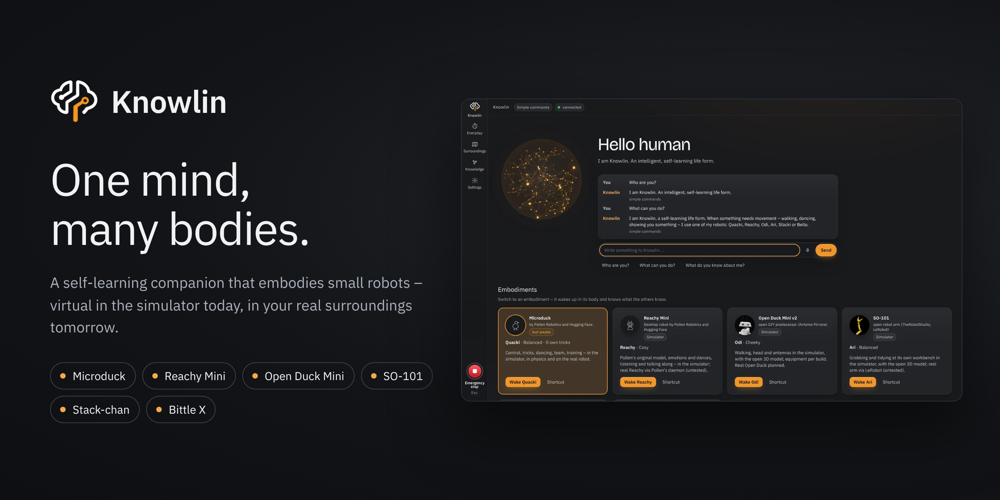
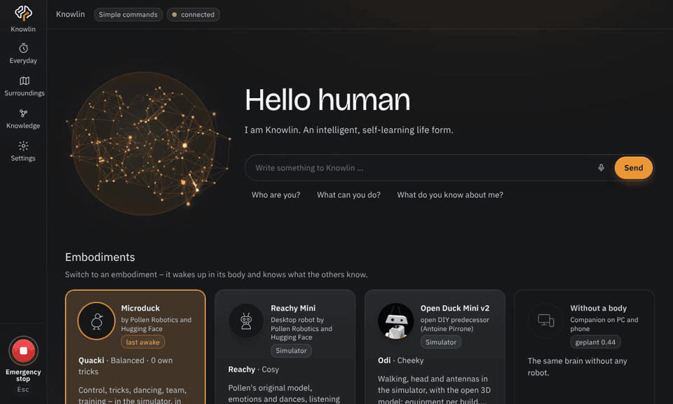
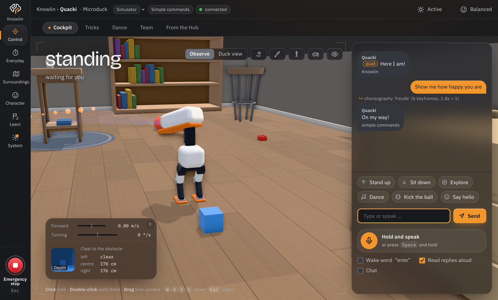
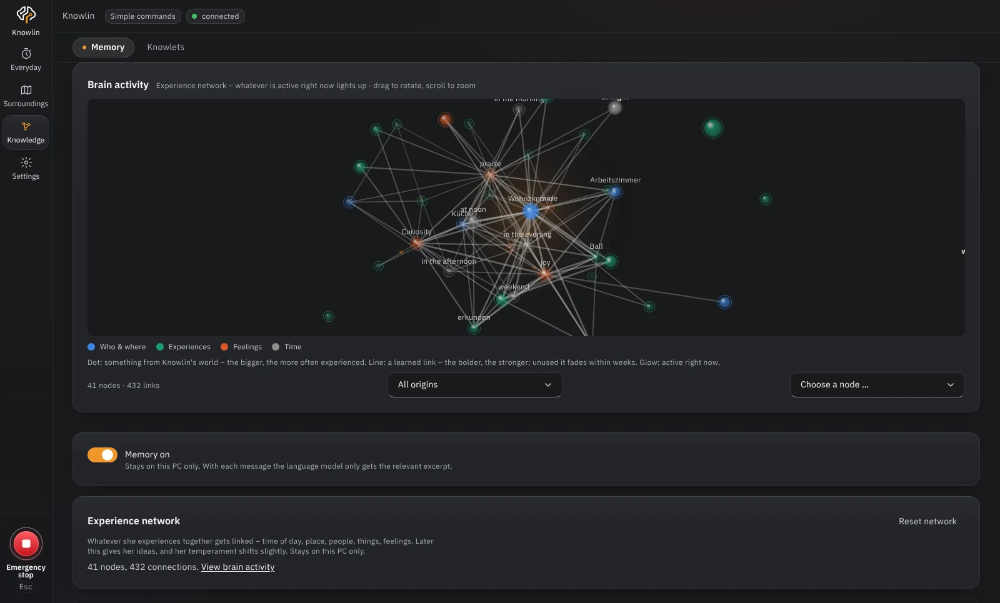
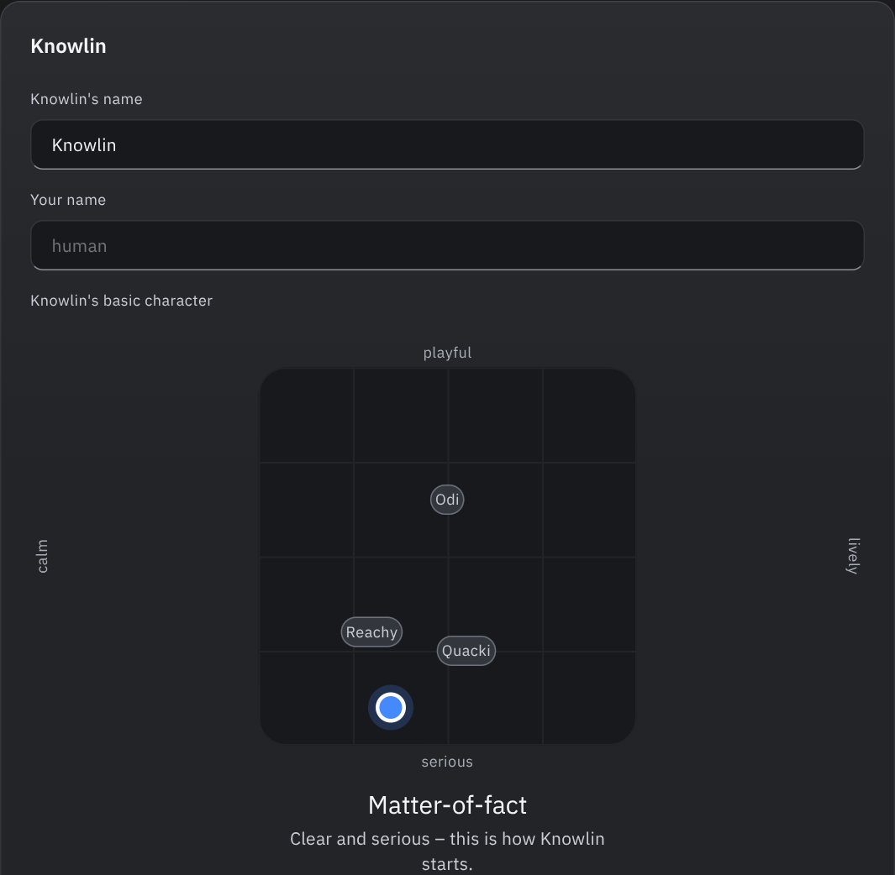
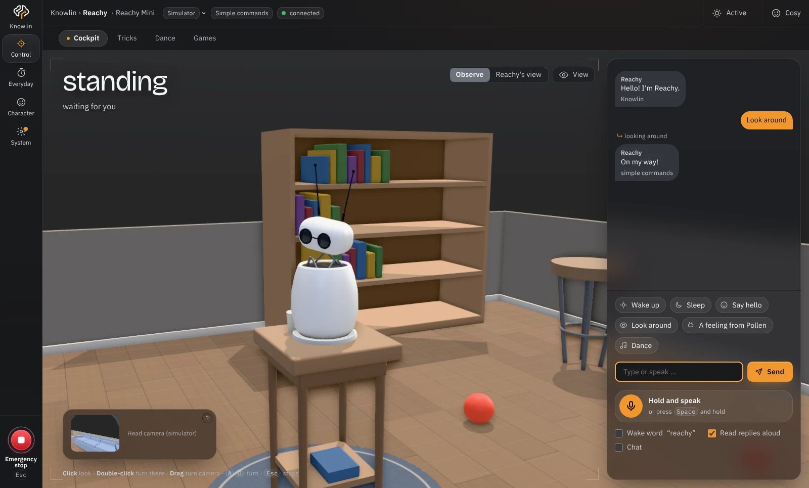
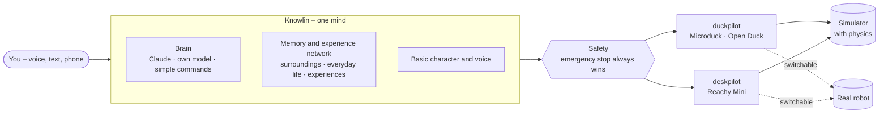

  

<h1 align="center">Knowlin</h1>

  <strong>One mind, many bodies.</strong> 
  A self-learning companion that embodies small robots – 
  virtual in the simulator today, then physically in your real surroundings.

  
  
  
  

  <a href="#quick-start">Quick start</a> ·
  <a href="#what-knowlin-does">Features</a> ·
  <a href="#bodies-and-modules">Bodies</a> ·
  <a href="#safety-and-privacy">Safety</a> ·
  <a href="#contributing">Contributing</a> ·
  <a href="README.md">Deutsch</a>

> [!NOTE]
> **Free, non-commercial hobby project.** Knowlin is not affiliated with Pollen Robotics, Hugging Face or the Open Duck
> project and is neither endorsed nor reviewed by them. Pollen's robot models are not included: Knowlin downloads them
> from the original source and prepares them on your PC – see [Legal and sources](#legal-and-sources).

> **Just want a look?** Pictures and an overview at [knowlin.de](https://knowlin.de).

## The idea

**Knowlin** is one shared mind for several robots. It knows your surroundings, your everyday life and the things you
have experienced together – and takes on a body depending on the task: the walking **Microduck**, the self-built
**Open Duck Mini** or the desk robot **Reachy Mini**. Each **embodiment** has its own name, voice and character; the
knowledge is shared.

Without a body, Knowlin is calm and matter-of-fact. When something needs movement – walking, dancing, showing you
something – it suggests the right robot and asks whether to use it.

  <picture>
    <!-- with “reduce motion” switched on, a still image instead of the animation -->
    <source media="(prefers-reduced-motion: reduce)" srcset="docs/bilder/startseite-en.png">
    
  </picture>

## What Knowlin does

<table>
  <tr>
    <td width="50%" valign="top">
       
      <strong>Voice and Claude</strong> 
      Free sentences, wake word or push-to-talk: Claude understands, plans sequences and rehearses new moves invisibly in
      the physics first. Simple commands also work without AI – or with your own model on your graphics card.
    </td>
    <td width="50%" valign="top">
       
      <strong>Memory and experience network</strong> 
      Knowlin remembers places, things, tricks and what you tell it – and where it learned it: without a body or in which
      embodiment, in the simulator or on the real robot. Everything stays on your PC.
    </td>
  </tr>
  <tr>
    <td width="50%" valign="top">
       
      <strong>One character, many variations</strong> 
      Pick Knowlin's basic character on a field between calm and lively, serious and playful. Each embodiment has its
      own variation and the traits of its form – from beak clattering to antenna play.
    </td>
    <td width="50%" valign="top">
       
      <strong>Dancing, games, everyday life</strong> 
      Dances on the beat, Pollen's emotions, camera games with Reachy (“Red light, green light”), timers, reminders and
      appointments – and a phone remote on your own Wi-Fi.
    </td>
  </tr>
</table>

**Also:** its own voice running locally (Piper, or a sound designed with Qwen3-TTS) · speech recognition and chatting ·
simulator with a living room, things to play with and optional real physics · tricks from the Hugging Face Hub, courses
and training (free on your PC or on Kaggle) · **Knowlets**: share character, tricks and dances as a package – data only,
never knowledge about people · interface in English and German.

## Bodies and modules

The modules have code names by kind of body: **duckpilot** for the walking ducks, **deskpilot** for stationary desk
robots. Every body shows only what it can do – what it lacks (legs, depth sensor, beak …) simply isn't there.

| Embodiment | Body | Module | Maker | In the simulator | Real robot |
|---|---|---|---|---|---|
| **Quacki** | Microduck | duckpilot | Pollen Robotics and Hugging Face | simple and with real physics | via `robotd` (Pollen's daemon) |
| **Odi** | Open Duck Mini v2 | duckpilot | Antoine Pirrone and community | open model: walking, head, antennas, avoids obstacles with its camera | planned |
| **Reachy** | Reachy Mini | deskpilot | Pollen Robotics and Hugging Face | Pollen's model, emotions, dances, games | via Pollen's daemon (untested) |

## Quick start

**Windows**

1. Install Python 3.11 or newer (python.org, tick “Add to PATH”).
2. Double-click `start.bat`. The first time (a few minutes) it creates a Python environment under
   `%LOCALAPPDATA%\duckpilot` – **not** in your OneDrive folder –, installs the packages and adds two shortcuts to the desktop
   and start menu: **Knowlin** (home page) and **duckpilot** (straight to the Microduck). Knowlin then opens in its own window.
3. The **First steps** assistant walks you through language, body, brain and the safety rules. For Claude, paste your
   Anthropic API key (platform.claude.com → Settings → API keys). It is stored in the operating system's vault, never in
   a file. Without a key, simple commands work (“walk forward”, “dance”, “stop”).

**macOS and Linux:** `./start.sh` (console and browser) or `./start.sh --app` (own window with Chrome/Edge).
Needs Python 3.11 or newer; on Debian/Ubuntu also `python3-venv`. The browser's speech recognition only exists in
Chrome and Edge – on Linux, use local recognition instead (Settings → Conversation →
Speech recognition “Local”, after a one-time `.venv/bin/pip install faster-whisper`).

More about starting: window, console, updates

- **The window** is Microsoft Edge in app mode with its own profile under `%LOCALAPPDATA%\duckpilot\fenster` – an
  embedded window couldn't use the browser's speech recognition. Without Edge, Knowlin uses Chrome, otherwise your
  default browser.
- **Console instead of window:** `start.bat` with arguments, e.g. `start.bat --backend robotd --robot tcp:127.0.0.1:7900`.
  Logs in window mode are in `%LOCALAPPDATA%\duckpilot\duckpilot.log`.
- **Updates:** run `start.bat` again – it only installs what changed. Closing the window ends Knowlin after a few seconds.
- **For developers:** `pip install -e ".[dev]"`, then `python -m duckpilot` (the Python package is called `duckpilot` for
  historical reasons).

## Safety and privacy

| | |
|---|---|
| **Emergency stop wins** | <kbd>Esc</kbd>, the red button or “Stop” halt everything at once – with or without AI. Afterwards nothing stands up or sits down by itself for at least two minutes (can only be made longer). |
| **Keys** | only in the operating system's vault, never in files, logs or reports. |
| **People and camera** | faces and names only on the PC, only when enrolled and with consent. Camera games analyse the image only in the browser – no image leaves the PC. |
| **Data** | map, sightings and memory stay on this PC and never go into a Knowlet. |
| **Costs** | paid cloud training only starts after two clicks. |

Please report security issues privately: [`SECURITY.md`](SECURITY.md).

## Accessibility

The goal is **WCAG 2.2 AA**: fully usable by keyboard, contrast checked, “reduce motion” respected. Every view is
checked automatically with axe-core; testing with real screen readers (NVDA, VoiceOver) is still to do – feedback is
very welcome. Details (German): [`docs/barrierefreiheit.md`](docs/barrierefreiheit.md).

## Documentation

- [User manual](docs/handbuch.md) (German) – every area and feature in detail
- [ARCHITECTURE.md](ARCHITECTURE.md) (German) – structure, layers and where things belong
- [CHANGELOG.md](CHANGELOG.md) (German) · [Release notes](docs/releases/) (English and German) · [Roadmap](docs/ROADMAP.md)

## Contributing

Contributions are welcome – code, translations, dances, tests or reports from a real robot. Start with
[`CONTRIBUTING.md`](CONTRIBUTING.md) and the issues labelled
[`good first issue`](https://github.com/knowlin-ai/knowlin/labels/good%20first%20issue). Questions and show & tell are
welcome in [Discussions](https://github.com/knowlin-ai/knowlin/discussions). Please follow the
[Code of Conduct](CODE_OF_CONDUCT.md).

## Legal and sources

Knowlin is a **free, non-commercial hobby project** for small robots. It is not affiliated with, endorsed or
reviewed by Pollen Robotics or Hugging Face. Knowlin is licensed under the **Apache License 2.0** (`LICENSE`), © 2026 The Knowlin Authors; built with Claude
(Anthropic). “Microduck” and “Reachy Mini” are names of Pollen Robotics; “Open Duck Mini” is a project by Antoine Pirrone. Contributions and their licences are listed in
`NOTICE` and in the app under System → Settings → About.
On GitHub: [knowlin-ai/knowlin](https://github.com/knowlin-ai/knowlin) – maintainer [@knowlin-dev](https://github.com/knowlin-dev).

| What | Source | Licence | In Knowlin |
|---|---|---|---|
| 3D parts (STL) | [pollen-robotics/microduck_rl](https://github.com/pollen-robotics/microduck_rl) | [CC BY-NC-SA 4.0](https://creativecommons.org/licenses/by-nc-sa/4.0/), © Pollen Robotics | **not included** – downloaded on first start and prepared on your PC |
| Robot model (MJCF) | [pollen-robotics/microduck_rl](https://github.com/pollen-robotics/microduck_rl) | Apache-2.0 | **not included** – as above |
| Policies | [pollen-robotics/microduck-policies](https://huggingface.co/pollen-robotics/microduck-policies) | see there | **not included** – loaded on request |
| 14 emotions, sounds | [pollen-robotics/microduck_emotions](https://github.com/pollen-robotics/microduck_emotions) | Apache-2.0 | converted (`tools/import_emotions.py`) |
| Duck voice, gesture sounds | [microduck_emotions](https://github.com/pollen-robotics/microduck_emotions), [microduck](https://github.com/pollen-robotics/microduck) | Apache-2.0 | rendered with Pollen's synthesiser |
| three.js | [mrdoob/three.js](https://github.com/mrdoob/three.js) | MIT | `static/vendor/` |
| IBM Plex Sans and Mono | [IBM/plex](https://github.com/IBM/plex) | SIL OFL 1.1 | `static/vendor/plex/` |
| Design | [IBM Carbon Design System](https://carbondesignsystem.com) | Apache-2.0 | rebuilt in `static/ds/` |
| Reachy Mini: 3D parts, kinematics | [pollen-robotics/reachy_mini](https://github.com/pollen-robotics/reachy_mini) | hardware CC BY-NC-SA 4.0, software Apache-2.0 | **not included** – downloaded on request and prepared on your PC |
| Reachy Mini: emotions and dances | Pollen's datasets on Hugging Face | see there | **not included** – downloaded on request |
| Hand detection (camera games) | MediaPipe Hand Landmarker: [`@mediapipe/tasks-vision` 0.10.21](https://www.npmjs.com/package/@mediapipe/tasks-vision) and the model `hand_landmarker.task` (float16/1) by Google | Apache-2.0 | **not included** – downloaded only on click (fixed version, checksums in `modell/hand_quellen.json`), runs only in the browser |
| Open Duck Mini v2: 3D model | [apirrone/Open_Duck_Mini](https://github.com/apirrone/Open_Duck_Mini) | Apache-2.0 | prepared and included (`static/model/open_duck_mini.dpm`, see `LIZENZ-open-duck-mini.md`) |

All changes per version: [`CHANGELOG.md`](CHANGELOG.md) (German).
