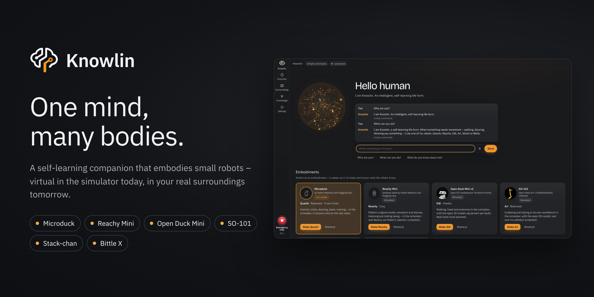
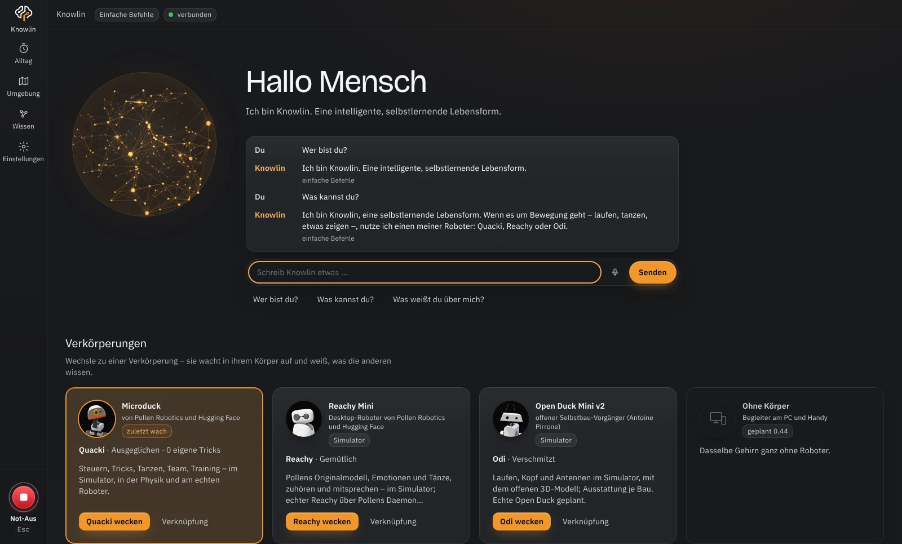
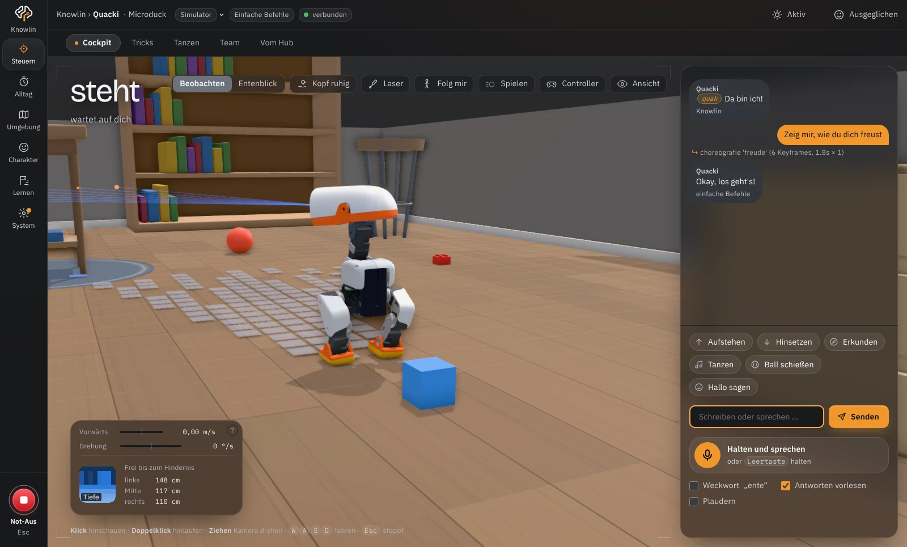
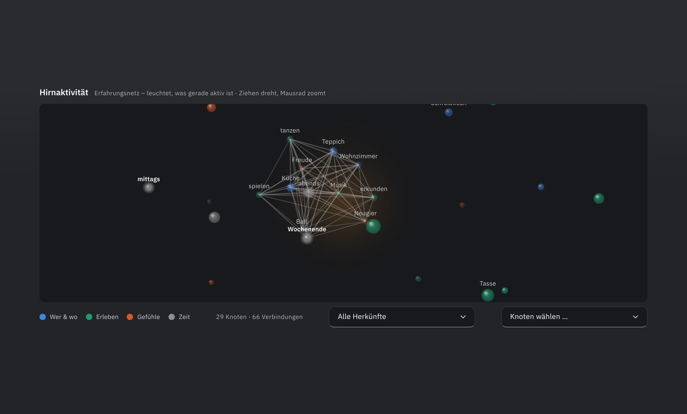
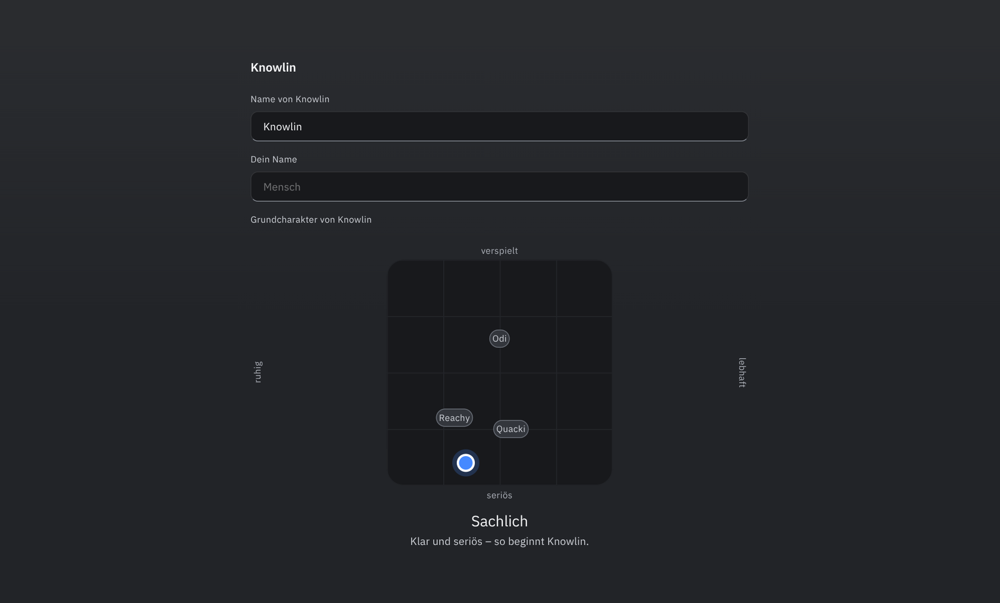
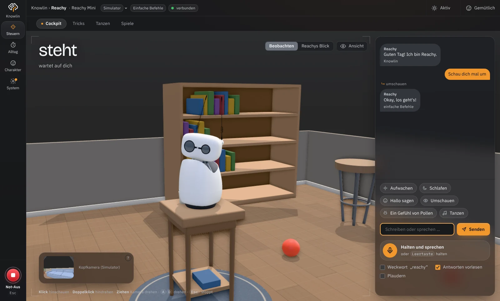
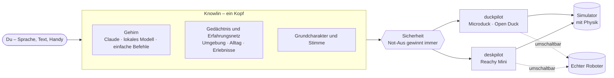

  

<h1 align="center">Knowlin</h1>

  <strong>Ein Kopf, viele Körper.</strong> 
  Ein selbstlernender Begleiter, der kleine Roboter verkörpert – 
  heute virtuell im Simulator, dann physisch in deiner echten Umgebung.

  
  
  
  

  <a href="#schnellstart">Schnellstart</a> ·
  <a href="#was-knowlin-kann">Funktionen</a> ·
  <a href="#körper-und-module">Körper</a> ·
  <a href="#sicherheit-und-datenschutz">Sicherheit</a> ·
  <a href="#mitmachen">Mitmachen</a> ·
  <a href="README.en.md">English</a>

> [!NOTE]
> **Freies, nicht-kommerzielles Hobbyprojekt.** Knowlin steht in keiner Verbindung zu Pollen Robotics, Hugging Face oder
> dem Open-Duck-Projekt und wird von ihnen weder unterstützt noch geprüft. Pollens Robotermodelle sind nicht enthalten:
> Knowlin lädt sie von der Originalquelle und bereitet sie auf deinem PC auf – siehe [Rechtliches und Quellen](#rechtliches-und-quellen).

> **Erst mal schauen?** Bilder und Überblick auf [knowlin.de](https://knowlin.de).

## Die Idee

**Knowlin** ist ein gemeinsamer Kopf für mehrere Roboter. Er kennt deine Umgebung, deinen Alltag und eure gemeinsamen
Erlebnisse – und schlüpft je nach Aufgabe in einen Körper: in die laufende Ente **Microduck**, die selbst gebaute
**Open Duck Mini** oder den Tisch-Roboter **Reachy Mini**. Jede **Verkörperung** hat ihren eigenen Namen, ihre Stimme
und ihren Charakter; das Wissen teilen sie.

Ohne Körper ist Knowlin ruhig und sachlich. Wenn es um Bewegung geht – laufen, tanzen, etwas zeigen –, schlägt er den
passenden Roboter vor und fragt, ob er ihn nutzen soll.

  

## Was Knowlin kann

<table>
  <tr>
    <td width="50%" valign="top">
       
      <strong>Steuern mit Sprache und Claude</strong> 
      Freie Sätze, Weckwort oder Taste: Claude versteht, plant Abfolgen und übt neue Bewegungen erst unsichtbar in der
      Physik. Einfache Befehle gehen auch ohne KI – oder mit einem lokalen Modell auf deiner Grafikkarte.
    </td>
    <td width="50%" valign="top">
       
      <strong>Gedächtnis und Erfahrungsnetz</strong> 
      Knowlin merkt sich Orte, Dinge, Tricks und was du erzählst – und woher er es weiß: ohne Körper oder in welcher
      Verkörperung, im Simulator oder am echten Roboter. Alles bleibt auf deinem PC.
    </td>
  </tr>
  <tr>
    <td width="50%" valign="top">
       
      <strong>Ein Charakter, viele Ausprägungen</strong> 
      Knowlins Grundcharakter wählst du im Feld zwischen ruhig und lebhaft, seriös und verspielt. Jede Verkörperung hat
      ihre eigene Ausprägung und die Eigenschaften ihrer Gestalt – vom Schnabelklappern bis zum Antennenspiel.
    </td>
    <td width="50%" valign="top">
       
      <strong>Tanzen, Spielen, Alltag</strong> 
      Tänze im Takt der Musik, Pollens Emotionen, Kamera-Spiele mit Reachy („Rotes Licht, grünes Licht“), Timer,
      Erinnerungen und Termine – und eine Handy-Fernbedienung im eigenen WLAN.
    </td>
  </tr>
</table>

**Außerdem:** eigene Stimme lokal auf dem PC (Piper oder ein mit Qwen3-TTS entworfener Klang) · Spracherkennung und
Plaudern · Simulator mit Wohnzimmer, Dingen zum Spielen und auf Wunsch echter Physik · Tricks vom Hugging Face Hub,
Parcours und Training (kostenlos am PC oder auf Kaggle) · **Knowlets**: Charakter, Tricks und Tänze als Paket teilen –
nur Daten, nie Wissen über Personen · Oberfläche auf Deutsch und Englisch.

## Körper und Module

Die Module tragen Codenamen nach Bauart: **duckpilot** für die laufenden Enten, **deskpilot** für stationäre Roboter auf
dem Tisch. Jeder Körper zeigt nur, was er kann – was fehlt (Beine, Tiefensensor, Schnabel …), ist gar nicht erst da.

| Verkörperung | Körper | Modul | Hersteller | Im Simulator | Echter Roboter |
|---|---|---|---|---|---|
| **Quacki** | Microduck | duckpilot | Pollen Robotics und Hugging Face | einfach und mit echter Physik | über `robotd` (Pollens Daemon) |
| **Odi** | Open Duck Mini v2 | duckpilot | Antoine Pirrone und Community | offenes Modell: laufen, Kopf, Antennen, mit Kamera ausweichen | geplant |
| **Reachy** | Reachy Mini | deskpilot | Pollen Robotics und Hugging Face | Pollens Modell, Emotionen, Tänze, Spiele | über Pollens Daemon (ungetestet) |
| – | LeRobot-Roboter (SO-101, LeKiwi …) | lerobot | Hugging Face LeRobot | – | über LeRobot (Arm, Greifer, Räder; ungetestet) |

**Dein eigener Roboter:** Über die [Körperschnittstelle](docs/koerper-schnittstelle.md) bekommt jeder Roboter Knowlin –
als eigenes Python-Paket, ohne Knowlin zu ändern. Er beschreibt in einem Profil, was er kann, und besteht die
Sicherheitsprüfung (`python -m duckpilot.koerper_pruefung`). Vorlage: [`examples/knowlin-koerper-vorlage`](examples/knowlin-koerper-vorlage).

## Schnellstart

**Windows – mit dem Installer (empfohlen)**

1. [**Knowlin-Setup herunterladen**](https://github.com/knowlin-ai/knowlin/releases/latest) – unter „Assets“ die Datei
   `Knowlin-Setup-….exe`.
2. Doppelklicken. Python ist dabei, Administratorrechte braucht es nicht. Zeigt Windows „Der Computer wurde durch
   Windows geschützt“, auf **Weitere Informationen → Trotzdem ausführen** klicken – der Installer ist noch nicht
   signiert.
3. Knowlin startet über **Knowlin** im Startmenü oder auf dem Desktop. Der Assistent **Erste Schritte** führt durch
   Sprache, Körper, Gehirn und die Sicherheitsregeln. Für Claude den Anthropic-API-Schlüssel einfügen
   (platform.claude.com → Settings → API keys). Er landet im Tresor des Betriebssystems, nie in einer Datei. Ohne
   Schlüssel funktionieren einfache Befehle („lauf vor“, „tanz“, „stopp“).

Updates: den neuen Installer einfach drüber installieren – Gedächtnis und Einstellungen bleiben. Deinstallieren über
Windows-Einstellungen → Apps.

**Mit Python (Windows, macOS, Linux):** `pipx install knowlin`, dann `knowlin --app` (eigenes Fenster) oder `knowlin`
(Konsole und Browser). Unter Windows legt `knowlin --verknuepfung` die Einträge im Startmenü und auf dem Desktop an.
Updates mit `pipx upgrade knowlin`.

**Aus dem Quellcode:** Repository klonen, dann unter Windows `start.bat` doppelklicken. Beim ersten Mal legt es eine
Python-Umgebung unter `%LOCALAPPDATA%\duckpilot` an (nicht im OneDrive-Ordner), installiert die Pakete und die
Verknüpfungen.

Unter macOS und Linux aus dem Quellcode: `./start.sh` (Konsole und Browser) oder `./start.sh --app` (eigenes Fenster mit Chrome/Edge).
Braucht Python 3.11 oder neuer; unter Debian/Ubuntu zusätzlich `python3-venv`. Die Spracherkennung des Browsers gibt
es nur in Chrome und Edge – unter Linux hilft die lokale Erkennung (Einstellungen → Gespräch →
Spracherkennung „Lokal“, dazu einmal `.venv/bin/pip install faster-whisper`).

Mehr zum Start: Fenster, Konsole, Updates

- **Das Fenster** ist Microsoft Edge im App-Modus mit eigenem Profil unter `%LOCALAPPDATA%\duckpilot\fenster` – ein
  eingebettetes Fenster könnte die Spracherkennung des Browsers nicht. Ohne Edge nimmt Knowlin Chrome, ohne beide den
  Standardbrowser.
- **Konsole statt Fenster:** `start.bat` mit Argumenten, z. B. `start.bat --backend robotd --robot tcp:127.0.0.1:7900`.
  Meldungen im Fenster-Modus stehen in `%LOCALAPPDATA%\duckpilot\duckpilot.log`.
- **Updates aus dem Quellcode:** `start.bat` erneut ausführen – es installiert nur, was sich geändert hat. Schließt du
  das Fenster, beendet sich Knowlin nach ein paar Sekunden von selbst.
- **Für Entwickler:** `pip install -e ".[dev]"`, dann `python -m duckpilot` (das Python-Paket heißt aus historischen
  Gründen `duckpilot`).

## Sicherheit und Datenschutz

| | |
|---|---|
| **Not-Aus gewinnt** | <kbd>Esc</kbd>, der rote Knopf oder „Stopp“ halten sofort alles an – mit oder ohne KI. Danach steht oder setzt sich eine Weile nichts von selbst – Standard zwei Minuten, einstellbar von 15 Sekunden bis 10 Minuten. |
| **Schlüssel** | nur im Tresor des Betriebssystems, nie in Dateien, Protokollen oder Berichten. |
| **Personen und Kamera** | Gesichter und Namen nur am PC, nur angelernt und mit Einwilligung. Kamera-Spiele werten das Bild nur im Browser aus – kein Bild verlässt den PC. |
| **Daten** | Karte, Sichtungen und Gedächtnis bleiben auf diesem PC und gehen nie in ein Knowlet. |
| **Kosten** | Bezahltes Training in der Cloud startet nur mit zwei Klicks. |
| **Updates** | Einmal am Tag eine Anfrage an GitHub, ob es eine neue Version gibt (abschaltbar). Aktualisiert wird nur auf deinen Klick, mit Prüfsumme und nie, während der echte Roboter verbunden ist. |

Sicherheitslücken bitte vertraulich melden: [`SECURITY.md`](SECURITY.md).

## Barrierefreiheit

Ziel ist **WCAG 2.2 AA**: komplett per Tastatur bedienbar, Kontraste geprüft, „Bewegung reduzieren“ wird
respektiert. Jede Ansicht wird automatisch mit axe-core geprüft; ein Test mit echten Screenreadern (NVDA, VoiceOver)
steht noch aus – Rückmeldungen sind sehr willkommen. Details: [`docs/barrierefreiheit.md`](docs/barrierefreiheit.md).

## Dokumentation

- [Handbuch](docs/handbuch.md) – alle Bereiche und Funktionen im Detail
- [ARCHITECTURE.md](ARCHITECTURE.md) – Aufbau, Schichten und wo was hingehört
- [Körperschnittstelle](docs/koerper-schnittstelle.md) – wie ein weiterer Roboter Knowlin bekommt
- [Code signing policy](docs/code-signing-policy.md) – wie der Windows-Installer gebaut und (bald) signiert wird
- [CHANGELOG.md](CHANGELOG.md) – Änderungen je Version · [Release-Notes](docs/releases/) · [Roadmap](docs/ROADMAP.md)

## Mitmachen

Beiträge sind willkommen – Code, Übersetzungen, Tänze, Tests oder Berichte vom echten Roboter. Einstieg:
[`CONTRIBUTING.md`](CONTRIBUTING.md) und die Issues mit
[`good first issue`](https://github.com/knowlin-ai/knowlin/labels/good%20first%20issue). Fragen und Vorstellungen gern
in den [Discussions](https://github.com/knowlin-ai/knowlin/discussions). Es gilt der [Code of Conduct](CODE_OF_CONDUCT.md).

## Rechtliches und Quellen

Knowlin ist ein **freies, nicht-kommerzielles Hobbyprojekt** für kleine Roboter. Es steht in
keiner Verbindung zu Pollen Robotics oder Hugging Face und wird von ihnen weder unterstützt noch geprüft.
„Microduck“ und „Reachy Mini“ sind Namen von Pollen Robotics, „Open Duck Mini“ ist ein Projekt von Antoine Pirrone. Der Quelltext von Knowlin steht unter der
**Apache License 2.0** (`LICENSE`), © 2026 The Knowlin Authors; entwickelt mit Claude (Anthropic). Wer was beigetragen
hat und unter welcher Lizenz, steht in `NOTICE` und in der App unter System → Einstellungen → Über.
Auf GitHub: [knowlin-ai/knowlin](https://github.com/knowlin-ai/knowlin) – Maintainer [@knowlin-dev](https://github.com/knowlin-dev).

| Was | Quelle | Lizenz | In Knowlin |
|---|---|---|---|
| 3D-Teile (STL) | [pollen-robotics/microduck_rl](https://github.com/pollen-robotics/microduck_rl) | [CC BY-NC-SA 4.0](https://creativecommons.org/licenses/by-nc-sa/4.0/), © Pollen Robotics | **nicht enthalten** – beim ersten Start von dort geladen und auf dem PC aufbereitet |
| Robotermodell (MJCF) | [pollen-robotics/microduck_rl](https://github.com/pollen-robotics/microduck_rl) | Apache-2.0 | **nicht enthalten** – wie oben |
| Policies | [pollen-robotics/microduck-policies](https://huggingface.co/pollen-robotics/microduck-policies) | siehe dort | **nicht enthalten** – auf Knopfdruck geladen |
| 14 Emotionen, Töne | [pollen-robotics/microduck_emotions](https://github.com/pollen-robotics/microduck_emotions) | Apache-2.0 | übersetzt (`tools/import_emotions.py`) |
| Entenstimme, Gesten-Laute | [microduck_emotions](https://github.com/pollen-robotics/microduck_emotions), [microduck](https://github.com/pollen-robotics/microduck) | Apache-2.0 | mit Pollens Synthesizer gerendert |
| three.js | [mrdoob/three.js](https://github.com/mrdoob/three.js) | MIT | `static/vendor/` |
| IBM Plex Sans und Mono | [IBM/plex](https://github.com/IBM/plex) | SIL OFL 1.1 | `static/vendor/plex/` |
| Gestaltung | [IBM Carbon Design System](https://carbondesignsystem.com) | Apache-2.0 | nachgebaut in `static/ds/` |
| Reachy Mini: 3D-Teile, Kinematik | [pollen-robotics/reachy_mini](https://github.com/pollen-robotics/reachy_mini) | Hardware CC BY-NC-SA 4.0, Software Apache-2.0 | **nicht enthalten** – auf Knopfdruck geladen und auf dem PC aufbereitet |
| Reachy Mini: Emotionen und Tänze | Pollens Datensätze auf Hugging Face (`reachy-mini-emotions-library`, `reachy-mini-dances-library`) | siehe dort | **nicht enthalten** – auf Knopfdruck geladen |
| Handerkennung (Kamera-Spiele) | MediaPipe Hand Landmarker: [`@mediapipe/tasks-vision` 0.10.21](https://www.npmjs.com/package/@mediapipe/tasks-vision) und Modell `hand_landmarker.task` (float16/1) von Google | Apache-2.0 | **nicht enthalten** – erst auf Klick geladen (fester Stand, Prüfsummen in `modell/hand_quellen.json`), läuft nur im Browser |
| Open Duck Mini v2: 3D-Modell | [apirrone/Open_Duck_Mini](https://github.com/apirrone/Open_Duck_Mini) | Apache-2.0 | aufbereitet enthalten (`static/model/open_duck_mini.dpm`, Hinweis in `LIZENZ-open-duck-mini.md`) |

Alle Änderungen je Version: [`CHANGELOG.md`](CHANGELOG.md); Release-Notes: [`docs/releases/`](docs/releases/).

App-Icons der öffentlichen Fassung zeigen das Knowlin-Zeichen (`tools/make_public_art.py`).
`tools/export_public.py` baut die öffentliche Fassung: ohne Pollens Modell, ohne private Bilder und Notizen,
mit Geheimnis-Scan.
